[**Shortwave**](#shortwave) *34 keys, 18 combos, 3.75 u high* 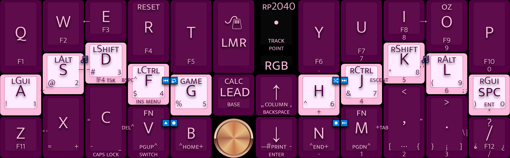

[**Minmax**](#minmax) *33 keys, 18 combos, 3 u high* 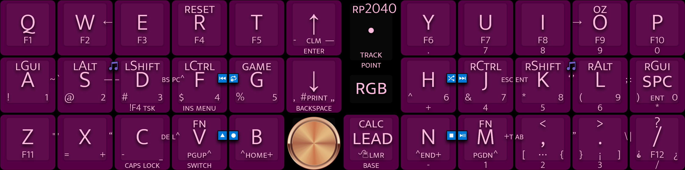 ***8*** *= 6 Japclm + 2 spin =* ***RJ45*** *= 6x3 + 1 5v rgb + [2 tp](https://redd.it/qh9h5g) =* ***12***

[**Asymmetry**](#asymmetry) *31 keys, 24 combos, 3 u high* 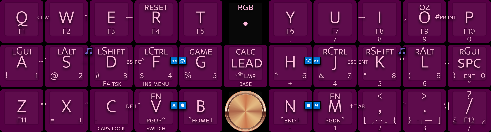 ***8*** *= 5x3 =* ***RJ45*** *= 6 clm only + 2 spin + [2 tp](https://redd.it/qh9h5g) + 1 5v rgb =* ***11***

[**Meme**](#meme) *22 keys, 55 combos, 2 u high* 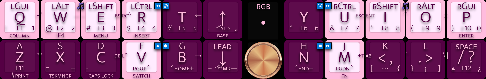 ***8*** *= 6x2 =* ***RJ45*** *= 6 clm only + 2 spin + [2 tp](https://redd.it/qh9h5g) + 1 5v rgb =* ***11***

[**RGB**](https://www.aliexpress.us/item/3256805596856612.html) *50 pcs best deal, 8 mm frosted: hides imperfections*

[**Trackpoint**](https://store.sprintek.com/Checkout.aspx) [***2 tp*** *= data, clock (rst, l, m, r)* ***+ 2 3v3, gnd***](https://redd.it/1wln421)

[**RJ45 sockets**](https://github.com/tompi/cheapino/blob/master/doc/orderingguide.md) *under top inside corners. Top outside flat.*

*[Gasket-mounted](https://m.youtube.com/watch?v=W4mXZvFGHDg) with [Poron foam.](https://www.aliexpress.us/item/3256805558411314.html?spm=a2g0n.productlist.0.0.509cjIJxjIJxMr&browser_id=0f164ffa0d8e4f1d9e58f3c6cf44baff&aff_platform=msite&m_page_id=upsli63jgcawjxdd1a20a2bcf3e14e360a4315d865&pdp_ext_f={"order"%3A"22"%2C"eval"%3A"1"%2C"fromPage"%3A"search"}&pdp_npi=6%40dis!USD!8.68!1.68!!!8.68!1.68!%402101e7a317954669729665116e1094!12000034189759391!sea!US!0!ABX!1!0!n_tag%3A-29910%3Bd%3A8e0e7696%3Bm03_new_user%3A-29895%3BpisId%3A5000000218165431&algo_pvid=5f3cd30e-1e40-4e05-95be-c51d1f3a7ef1&utparam-url=scene%3Asearch|query_from%3A|x_object_id%3A1005005744726066|_p_origin_prod%3A&gatewayAdapt=glo2usa)*

*[Magnets](https://www.amazon.com/s?k=adhesive+magnets) to join halves. Use hollow space for cable storage.*

*[Wrap like a bento](https://www.amazon.com/s?k=reversible+furoshiki) to protect keycaps. Total height = width.*

***3 cm*** *In > Out =* ***18°*** *tent.* ***1 cm*** *Bottom > Top =* ***-8–10°*** *tilt.*

Bottom Outside|Top Inside|Bottom Inside|+ 2 layers Cherry MX
:---:|:---:|:---:|:---:
1 cm|3 cm|4 cm|8 cm

18|Combos||
---:|:---:|:---
**2**|Arrows|Left, Right
**4**|Symbol|Tilde, Colon, Quote, Pipe
**4**|Unicode|Dash, Quote, Open & Close Dialog
**4**|Basic|Backspace, Enter Esc, Delete, Tab
**4**|Special|!F4 Tskmngr, Ins Menu, Caps, Switch

55|Combos|Meme
---:|:---:|:---
**11**|Oz|Home Row, Base
**10**|Fn|F1–F10
**10**|Numbers 
**2**|Misc|Column, #Print
**4**|Special|Tskmngr, Menu, Lead, Base

Dance|Mouse|Home End
---:|:---:|:---
**Tap**|Tap Left Click|Line Jump
**Hold**|Register Left Drag|**+** Line Select
**Tap-Tap**|Tap Middle Click|**^** File Jump
**Tap-Hold**|Tap Right Click|**+^** File Select

Layer|Spin|Tap|Implementation
---:|:---:|:---:|:---
**Oz**|BS Del|Mute|Game on hold
**Base**|↕|Mute|Game on hold
**Game**|Volume|Mute|Base on hold
**Calc**|←→|+|or BS Enter
**Fn**|Undo|^S
*Ctrl*|*Zoom*|***^0***|override tap
*Shift*|↔||*native*
***Alt***|***Find***|***^F***|override both
***Gui***|***^+←→***|***←***|override both

Color|Length|Meaning|||
---:|:---:|:---|---:|:---
**Green**|∞|Leader Go|**34**|**Keycaps**
**Green**|Blip|Base Alphas|**7**|1.75 U
**Green**|∞|Caps Lock|**4**|1.5 U
**Blue**|Blip|Game Lock|**4**|1.25 U
**Blue**|∞|Oz Lock|**19**|1 U
**Red**|∞|Calc Lock
**Red**|∞|OSL Fn 🖱LMR||Minmax

### Shortwave

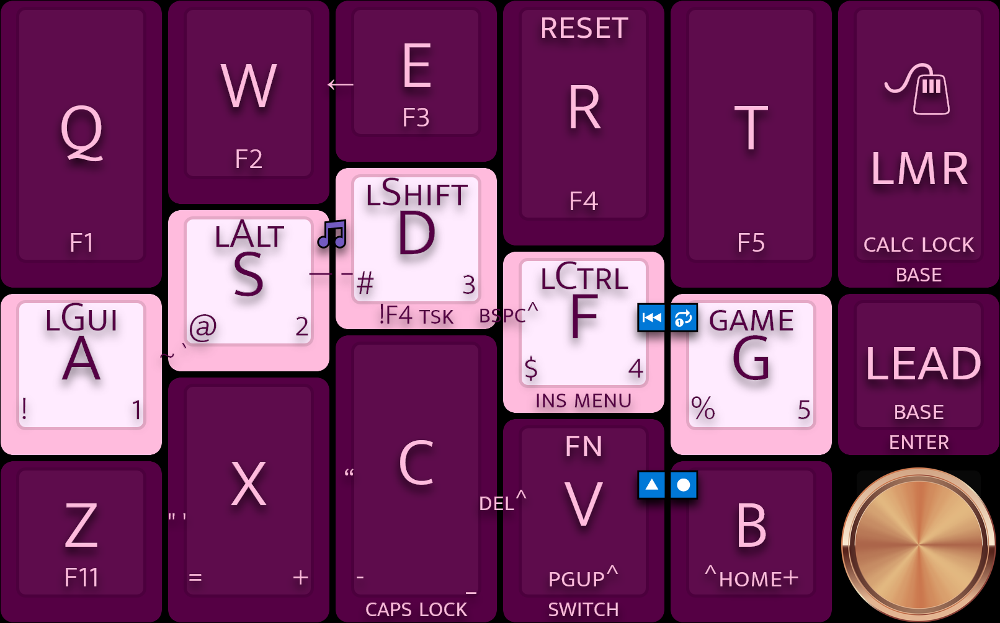

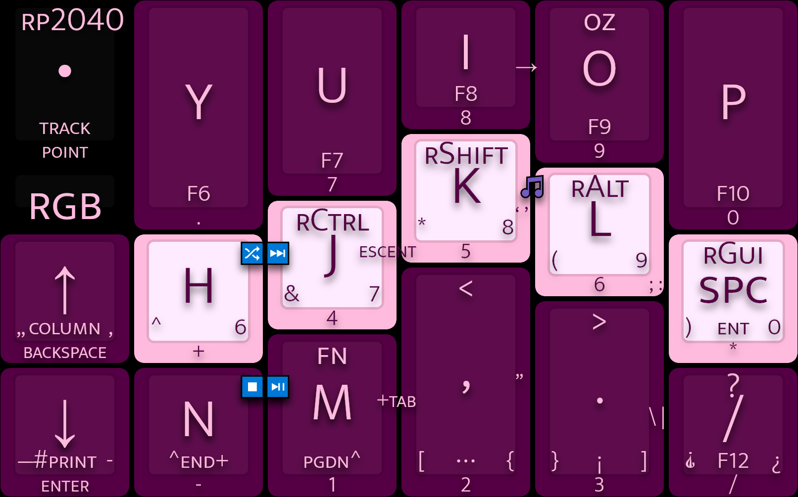

### Minmax

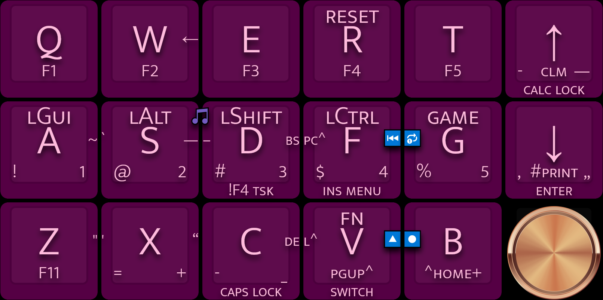

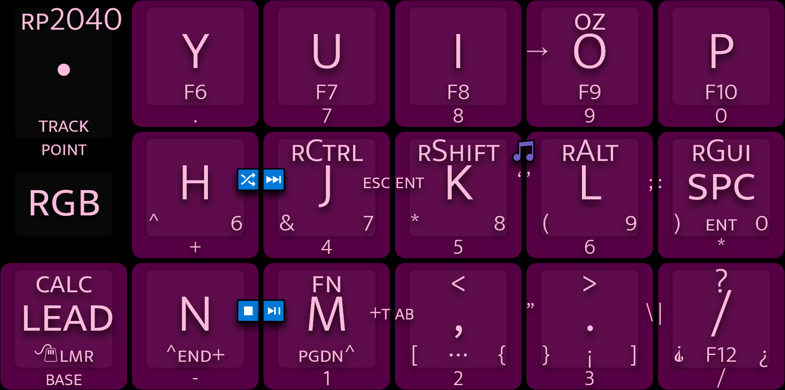

### Asymmetry

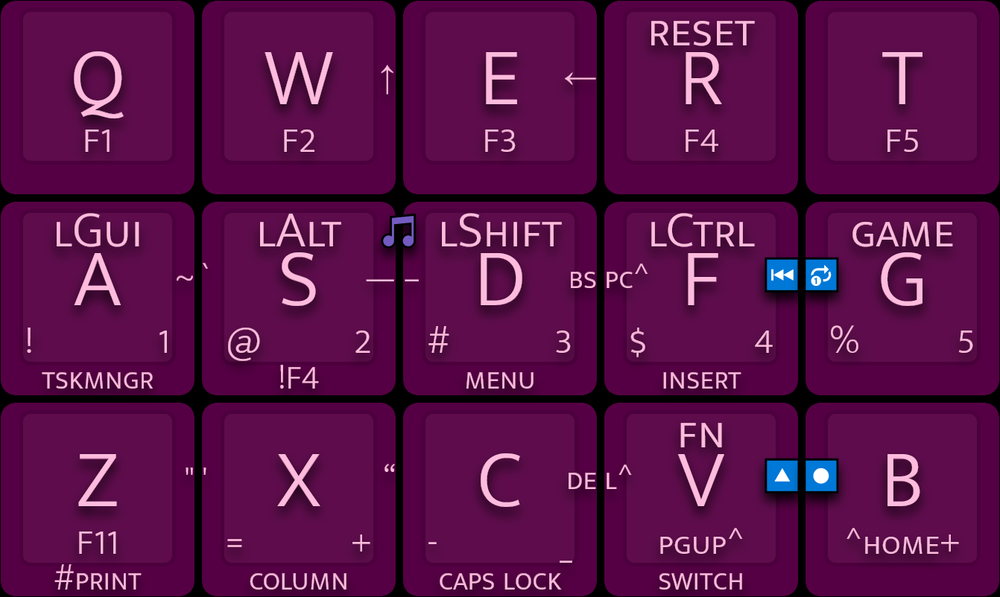

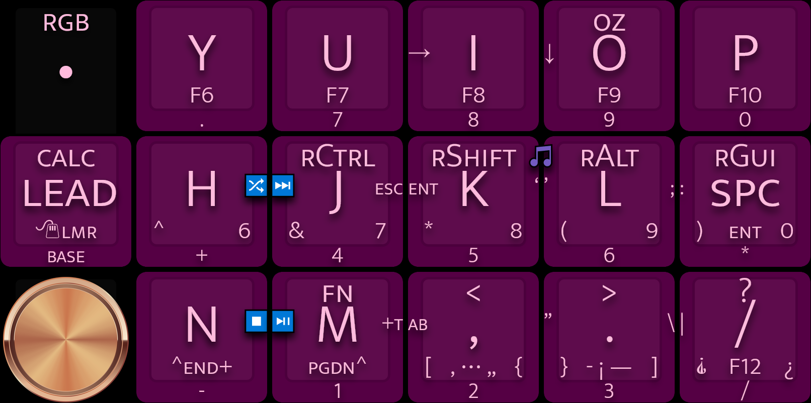

### Meme

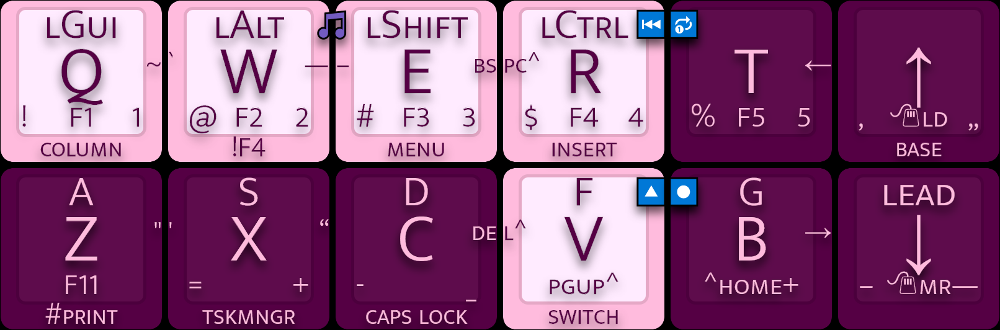

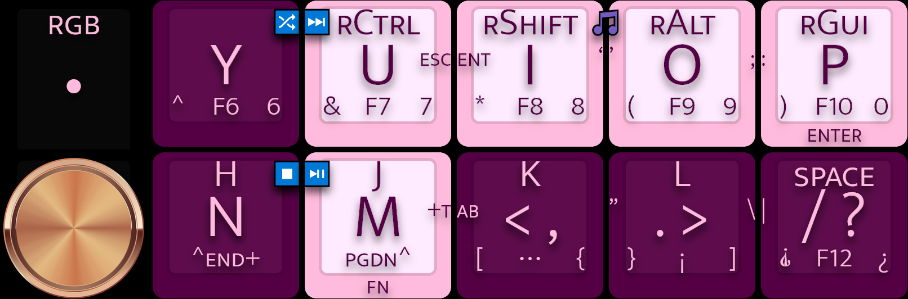
